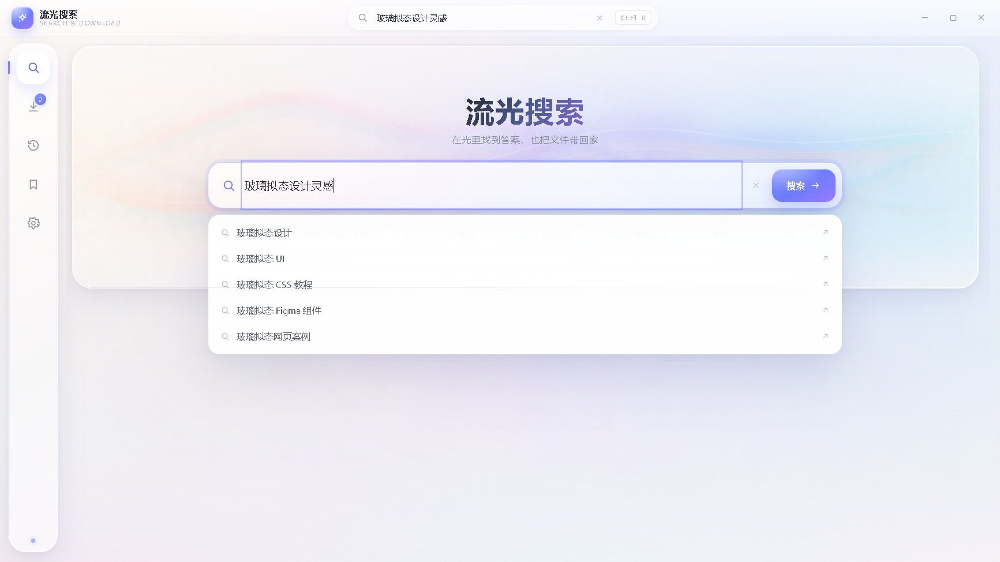
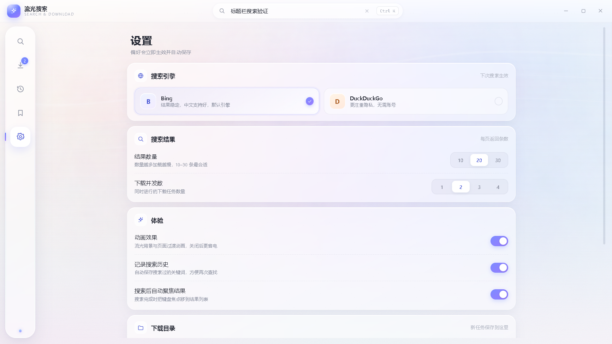

# 流光搜索 · 搜索引擎与下载器

> 一个白色基底、珠光流体背景的轻量搜索工具：搜网页、拿结果、直接下载文件。界面简约，玻璃质感，实时流体与鼠标交互；后台由主进程完成搜索聚合与下载队列，不依赖第三方库。

## 1. 打开方式

- 首页底部中间 **流光搜索** 卡片；
- 独立窗口打开（默认 1400×860，可缩放/最大化），关闭隐藏，下次保留状态；
- 与主面板分离，适合长时间搜索与下载。

## 2. 界面布局

- **左侧悬浮玻璃图标栏**：搜索 / 下载 / 历史 / 书签 / 设置；
- **顶部标题栏**：app 标记 + 名称 + 中央快速搜索框（任意页面可用）+ 窗口控制；
- **主区**：搜索首页是一张珠光流体卡片 + 大搜索框；搜索结果/下载/历史/设置以白色玻璃面板呈现；
- **流体背景**：Canvas 2D 绘制，中央 S 形珠光流带 + 全页低透明氛围；鼠标移动吸引、点击涟漪；滚动/静止时自然流动；可在设置中关闭「动画效果」：关闭后流体静态、过渡减弱；默认开启动画。

## 3. 搜索

- 输入关键词按 `Enter`，或点击「搜索」；支持 Web 搜索，默认引擎 **Bing**，可在设置切换为 **DuckDuckGo**；
- 搜索过程中显示骨架屏；结果每条包含站点图标/字母占位、标题、展示域名、摘要、引擎标签；
- 结果动作：打开网页、复制链接、**加入下载**（链接看起来是文件时出现）、收藏；
- 搜索结果右键菜单：打开 / 复制链接 / 加入下载 / 收藏；
- 支持分页/加载更多；支持在浏览器中打开当前搜索；
- 搜索历史自动记录（可在设置关闭），同一关键词合并去重；
- 建议下拉：输入时 180ms 防抖请求 DuckDuckGo 自动补全。

### 搜索实现

- 后端 `SearchService`：Bing RSS（`format=rss`）优先，失败自动降级 DuckDuckGo HTML；两者都失败时 UI 显示可读错误；
- `parse.ts` 纯函数解析 RSS/HTML，处理 HTML 实体、CDATA、DDG 跳转 `/l/?uddg=` 还原、广告过滤、可下载文件名识别；
- 搜索历史/书签/设置存 `%APPDATA%\便捷工具\search\`，原子写 JSON。

## 4. 下载器

- 顶部粘贴 http/https 文件直链，点「开始下载」或回车；也可以在搜索结果/右键菜单直接加入下载；
- 默认保存到 `下载\流光搜索`，可在设置或下载页选择目录；
- 队列卡片显示：文件名、来源域名、进度条/百分比、已下载/总大小、实时速度、状态；
- 支持：暂停 / 继续（Range 断点续传）、取消、重试、打开文件、打开文件夹、删除记录（可同时删文件）、清空已完成；
- 并发下载数可在设置调整（1–6，默认 2）；完成后保留历史记录；
- 下载进度由主进程广播事件 `search:downloads` 实时推送，UI 不轮询。

### 下载实现

- `DownloadService` 使用 Node fetch 流式读取并写盘，120ms 节流广播进度/速度；
- 暂停保留已下载字节，继续时带 `Range` 续传；服务器不支持 Range 时自动从头重下；
- 文件名优先 Content-Disposition，其次 URL，自动清洗非法字符并去重（` (1)`）；
- 下载记录原子写入 `search/downloads.json`；应用退出时中断进行中任务并标记错误，下次可重试；
- 仅允许 http/https，拒绝路径穿越；并发队列按 `settings.concurrentDownloads` 调度。

## 5. 历史 / 书签 / 设置

- **历史**：按日期分组，点击重新搜索；单条删除、清空（confirm）；
- **书签**：保存结果标题/URL/摘要，打开或删除；按 URL 去重；
- **设置**：
  - 搜索引擎：Bing / DuckDuckGo；
  - 结果数：10 / 20 / 30；
  - 下载并发：1–4；
  - 动画效果：关闭后流体静态、其他过渡减弱；
  - 历史记录开关；
  - 下载保存目录（选择目录）；
  - 清空搜索历史 / 下载记录。

## 6. 交互与快捷键

| 操作 | 说明 |
| --- | --- |
| `Enter` | 提交搜索 / 下载 URL |
| `/` | 聚焦搜索框 |
| `Esc` | 关闭弹层 / 从结果返回首页 |
| `Ctrl+K` | 聚焦顶部快速搜索 |
| 鼠标移动 / 点击 | 流体吸引 / 涟漪 |
| 拖拽 URL | 可粘贴到下载输入框 |

## 7. 架构与性能

- 独立 `search.html` 渲染层 + `search.ts` preload + `SearchWindowManager` 窗口；`SearchService` / `DownloadService` 在主进程，通过 `core` IPC 提供给渲染层；
- 流体组件 `FluidBackground`：单可见 canvas + 2 个离屏层（glow 0.22× / detail 0.5×），缓存渐变与 sprite 图集，每帧只做路径采样；DPR≤2 且 backing 像素 ≤1.2MP，软件光栅（`willReadFrequently`）避免截图/录制时 GPU 崩溃；页面隐藏、失焦、滚出视口暂停；`prefers-reduced-motion` 静态降级（可在工具设置中强制动画）；
- 搜索窗口关闭隐藏并开启 `backgroundThrottling`，后台不消耗动画性能；
- UI 状态本地维护，下载只依赖事件推送；列表渲染轻量，无第三方 UI 库。

## 8. 已知边界

- 搜索引擎聚合依赖外部 Bing/DuckDuckGo 服务，网络受限或反爬时会失败；可在设置切换引擎或直接「在浏览器搜索」；
- 图片/视频等媒体搜索未做独立 Tab（当前以网页结果为主）；
- 下载器不支持 BT/磁力/多线程分片加速（Range 续传为单连接）；
- 需要登录/防盗链的链接可能下载失败；
- 搜索建议来自公开自动补全接口，失败时静默不显示。

## 9. 验收

- `npx tsc -p tsconfig.json --noEmit`：0 错误；
- `node --test tests/search.test.mjs`：5/5（RSS/DDG 解析、降级、建议、设置/历史/书签、1MB 下载/进度、暂停恢复、并发/取消/重试/dispose）；
- 应用冒烟：22/22 通过（本地 RSS 2 条、256KB 下载完整、搜索窗口渲染与下载页截图）；
- 流体相邻帧哈希不同（动画运行），视觉截图见上。

