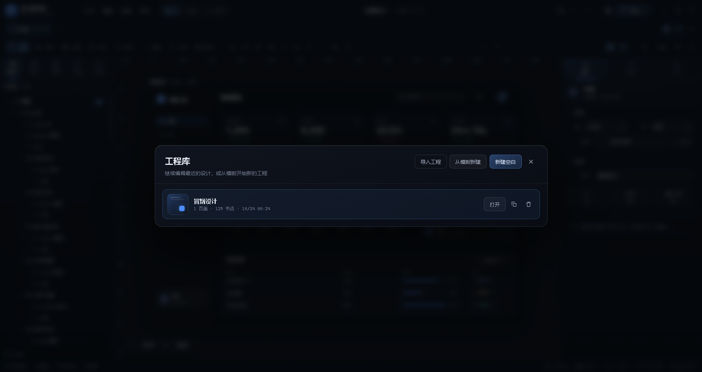

# UI 编辑器 · 使用与设计说明

> 一个内置在「便捷工具」里的可视化 UI 设计工作台：不写代码，像 Unity 一样拖拽布局、搭组件、调设计令牌、连交互原型，完成后可直接导出独立 HTML / React 组件 / 工程 JSON，或一键发布为应用内工具。


## 1. 打开方式

- 首页底部左侧 **UI 编辑器** 卡片；
- 托盘菜单 / 命令面板中的 **打开 UI 编辑器**；
- 关闭窗口只是隐藏，再次打开会恢复上次工程；所有编辑自动保存到 `%APPDATA%\便捷工具\uieditor\projects\`。

> 编辑器是独立的大窗口（默认最大化、可缩放），与主面板分离，避免小面板限制设计空间。

## 2. 界面布局

```
┌──────────────────────────────────────────────────────────────┐
│ 顶栏：工程名 / 文件·编辑·视图·帮助 / 设计·原型·预览 / 导出 / 窗口控制 │
├──────────────────────────────────────────────────────────────┤
│ 页面 tabs：仪表盘 1280×800  +                                  │
├──────────────────────────────────────────────────────────────┤
│ 工具栏：选择 平移 容器 矩形 圆形 线段 文本 图片 + 组件插入        │
│         对齐/分布 层级/编组 网格/吸附 缩放                      │
├────────────┬──────────────────────────────────┬──────────────┤
│ 左面板     │ 画布：网格 / 标尺 / 画板            │ 右面板        │
│ 图层       │ 选中框 / 缩放手柄 / 参考线          │ 属性 / 设计 / 交互 │
│ 组件       │                                  │              │
│ 模板       │                                  │              │
│ 页面       │                                  │              │
│ 资源       │                                  │              │
├────────────┴──────────────────────────────────┴──────────────┤
│ 状态栏：模式 / 页面尺寸 / 选中对象 / 节点数 / 缩放 / 操作提示      │
└──────────────────────────────────────────────────────────────┘
```

## 3. 三种模式

| 模式 | 用途 |
| --- | --- |
| 设计 | 拖拽、缩放、属性编辑、图层管理、设计令牌 |
| 原型 | 配置点击/悬停/加载交互，预览跳转与状态 |
| 预览 | 全屏运行设计稿，支持多页面跳转与状态反馈；`Esc` 退出 |

## 4. 画布操作

- **移动 / 缩放**：滚轮平移，`Ctrl + 滚轮` 缩放；空格或中键拖拽平移；工具栏缩放、`Ctrl+0` 适配、`Ctrl+1` 100%；
- **选择**：单击、`Shift/Ctrl` 多选、空白拖拽框选、方向键微调（`Shift` 10px）；
- **移动 / 尺寸**：拖拽选中框；8 向手柄缩放；旋转手柄 15° 吸附；移动时吸附 8px 网格、画板/兄弟节点边缘与中心，并显示参考线/间距；
- **创建**：选择容器/矩形/圆形/线段/文本/图片工具后在画布拖拽绘制；其他组件在工具栏点击即插入到画板中心；
- **内联编辑**：双击文本 / 按钮直接改文案，`Enter`/失焦提交，`Esc` 取消；
- **结构**：`Alt+拖拽`复制；`Ctrl+C/V/D` 复制粘贴；`Ctrl+G` 编组、`Ctrl+Shift+G` 解组；右键菜单可置顶/置底、显隐、锁定、复制、删除；
- **撤销**：`Ctrl+Z` / `Ctrl+Y`，历史栈 80 步；拖拽过程合并为一次历史；
- **对齐分布**：工具栏 6 种对齐 + 水平/垂直分布（≥3 个对象）；
- **图层**：左面板拖拽可前/后/内部换层级；双击重命名；眼睛/锁切换显隐/锁定。

## 5. 组件与模板

- **组件库**内置 29 个基础组件/组合，6 个分类：基础、布局、表单、数据、导航、媒体。包括矩形、圆形、文本、图片、图标、分割线、容器、卡片、弹性行/列、2×2 网格、按钮、输入框、文本域、开关、滑杆、进度条、Tabs、徽标、头像、数据卡片、列表项、统计块、顶栏、底部 TabBar、侧边栏、面包屑、媒体封面卡、播放控制条。
- 点击组件即以规范默认样式插入，可继续在画板内自由调整或直接改属性。
- **页面模板** 7 套：空白画布、深色登录页、数据仪表盘、设置面板、媒体播放器、移动端个人中心、团队看板。模板是从真实页面结构构建的完整节点树（35~125 个节点），不是占位图。
- 模板与组件都使用同一份 schema，可被导出器完整还原。

## 6. 右面板：属性 / 设计 / 交互

- **属性**：节点类型与名称、可见/锁定、X/Y/W/H、旋转、透明度、布局（free/row/column + gap/padding/align/justify）、填充/渐变、描边、四角圆角、阴影、模糊、文字（内容/字体/字号/字重/行高/字距/颜色/对齐/大小写/装饰），以及按钮/输入框/开关/滑杆/Tabs/列表等类型专属属性；多选支持批量修改与混合值。
- **设计令牌**：颜色、间距、圆角、文字样式四组；点击应用到选中节点；支持新增/编辑/删除，持久化到工程。
- **交互**：事件（click/hover/load）→ 动作（跳转页面/打开链接/返回/切换变量/命令/复制）→ 目标、过渡动画；可复制交互到其他选中节点；
- **状态样式**：hover / pressed / active / disabled 四个状态分别覆盖透明度、填充、描边、位移、模糊、阴影；预览时自动生效。

## 7. 多页面与工程

- 顶栏页面 tabs 新建/切换/双击重命名；左面板「页面」支持尺寸、背景、复制、删除；
- 顶栏工程库按钮（或 文件 → 最近工程）可打开工程库：打开、复制、删除、导入、从模板新建、新建空白；
- 工程自动保存（900ms 合并写入 + 失焦兜底），`Ctrl+S` 立即保存；
- 工程文件为纯 JSON，可在外部备份/版本管理；也可通过 文件 → 导入工程 载入。



## 8. 导出与发布

| 格式 | 说明 |
| --- | --- |
| **独立 HTML** | 单文件，内联全部样式/脚本/图片，无外部依赖；多页面切换、交互、状态、缩放适配完整；可直接发给别人或用浏览器打开 |
| **工程 JSON** | 完整工程数据，可再次导入编辑器 |
| **React 组件** | `index.tsx + styles.css + README.md`，嵌套 JSX 与内联样式，交互以 `data-action` 暴露给宿主接管 |
| **发布为应用内工具** | 自动生成用户插件（`plugin.json / index.html / main.js / icon.svg`），助手重启插件后出现在主面板工具列表，可直接打开 |

> HTML 导出的图片若是本地导入，会以 DataURL 内嵌；外部图片 URL 会原样输出，需要联网。
> 发布插件使用 ASCII 安全 id（如 `ui-design-a1b2`），显示名仍保留中文。

## 9. 性能与扩展

- 画布节点使用 `React.memo` 单独重绘；选择/悬浮/缩放/平移不重绘节点树；拖拽/缩放通过 `requestAnimationFrame` 合并更新，历史操作在 gesture 结束时一次提交；
- 工程采用规范化节点树（`nodes` 映射 + `children` 顺序），更新/撤销成本与选中子树相关；
- schema 中包含设计令牌、状态、交互、模板/预设注册表，新增组件类型或导出器无需修改画布核心；
- 组件预设、页面模板、导出器、渲染样式工具分别位于 `src/shared/uieditor-presets.ts`、`uieditor-templates.ts`、`src/main/core/uieditor/export.ts`、`uieditor-render.ts`，可直接扩展；
- 发布插件后，工具本身也可以在代码编辑器里继续修改。

## 10. 已知边界

- 当前布局系统支持 free / row / column；复杂网格请用容器嵌套或 2×2 预设；
- React 导出不含交互运行时，需要宿主接 `data-action` 事件委托；
- 原型交互目前覆盖页面跳转、链接、返回、切换显示/变量、命令，不含动画时间轴；
- 图片资源通过 DataURL 内嵌，工程会随图片体积增大；建议单张 ≤4MB；
- 单窗口单工程工作；多工程通过工程库切换。

## 11. 验收

- `npx tsc -p tsconfig.json --noEmit`：0 错误；
- `node --test tests/uieditor-export.test.mjs`：8/8；
- 真实应用 smoke：21/21 通过，包含 UI 编辑器工作台、dashboard 模板 125 节点渲染、预览、HTML 导出（真实 BrowserWindow 加载）、发布插件并出现在插件列表。

